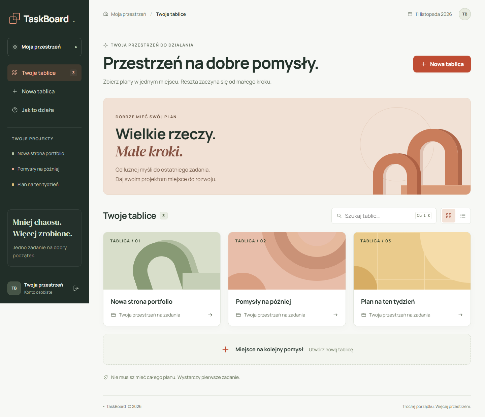

# TaskBoard

A task organizer with a Django interface and a separate FastAPI backend. Create boards, add tasks, track progress and keep each account's workspace private.



## Features

- Account registration and login with Argon2 password hashes and 30-minute JWTs.
- Boards and tasks restricted to their owner, including checks on nested task URLs.
- Task creation, editing, completion and deletion. Boards must be empty before deletion.
- Optional deadlines for boards and tasks. Task deadlines can be changed or cleared from the task editor.
- Responsive Django templates, plain CSS and JavaScript, keyboard navigation and reduced motion support.
- Board search, list and grid views, task filters, live previews and confirmation dialogs.
- Form validation and useful feedback when the API is unavailable.
- AI planning: describe a goal, edit proposed titles, set optional deadlines, skip unwanted tasks and save the selected tasks together.
- Task chat answers questions in Polish about tasks across your boards. Ask about unfinished work, completed tasks or a deadline range.

## Stack and layout

Python 3.14, Django 5.2, FastAPI, SQLAlchemy, Pydantic and SQLite. The frontend uses server-rendered HTML; JavaScript adds browser interactions without a frontend framework. Node.js runs the static-file formatter and browser tests. Ollama is optional for local AI generation.

```text
backend/                 FastAPI application, models, schemas and API tests
backend/ai/chat/         Chat service, model interface and task tool
backend/queries/         Account-scoped task queries
frontend/config/         Django settings, URLs and server entry points
frontend/pages/          Forms, views, API client and Django tests
frontend/pages/templates/pages/
                         Django templates and shared fragments
frontend/pages/static/taskboard/
                         CSS, JavaScript and favicon
practice/                Standalone SQLite and SQLAlchemy learning examples
scripts/init_env.py      Safe local configuration setup
```

Django keeps framework tables and server-side sessions in `frontend/db.sqlite3`. Application accounts, boards and tasks live in `backend/taskboard_dev.db`. Both database paths are independent of the current working directory.

## Run locally

The commands below use PowerShell from the repository root. Install Python 3.14 first.

```powershell
py -3.14 -m venv .venv
.\.venv\Scripts\python.exe -m pip install -r requirements-dev.txt
.\.venv\Scripts\python.exe scripts/init_env.py
.\.venv\Scripts\python.exe backend/create_tables.py
.\.venv\Scripts\python.exe frontend/manage.py migrate
```

The setup script generates two different random keys in `.env`. It preserves an existing file and never prints the keys. Git ignores `.env`, virtual environments, local databases and caches. `.env.example` documents the available settings. Explicit environment variables take precedence over `.env`.

Start the API in one terminal:

```powershell
.\.venv\Scripts\python.exe -m uvicorn main:app --app-dir backend --host 127.0.0.1 --port 8080 --reload
```

Start Django in another terminal, also from the repository root:

```powershell
.\.venv\Scripts\python.exe frontend/manage.py runserver 127.0.0.1:8001
```

Open [TaskBoard](http://127.0.0.1:8001/) and create an account. The API has [interactive documentation](http://127.0.0.1:8080/docs) and a [health endpoint](http://127.0.0.1:8080/health). On macOS or Linux, use `.venv/bin/python` in place of the Windows executable path.

`TASKBOARD_API_URL` configures the server-to-server connection from Django to FastAPI. Its default is `http://127.0.0.1:8080/`. Ordinary API requests have a five-second timeout. Planning requests allow the configured model timeout plus a fifteen-second network margin. The browser sends forms to Django rather than calling the API directly.

## AI planning

Open a board and choose **Zaplanuj z AI**. Describe the goal and choose a minimum and maximum number of tasks. Each proposal has an editable title and an optional **Termin** field. Adjust either field, mark unwanted proposals **Pomiń**, and add the selected tasks when the plan is ready. Generation never writes tasks to the database. The API validates titles, the requested count and duplicate proposals before returning the plan.

Two providers are supported:

| Setting                        | Behavior                                                                                                                      |
| ------------------------------ | ----------------------------------------------------------------------------------------------------------------------------- |
| `TASKBOARD_AI_PROVIDER=demo`   | Deterministic sample tasks for development and tests, visibly identified as demo output. No model service is contacted.       |
| `TASKBOARD_AI_PROVIDER=ollama` | Real generation through the configured Ollama chat endpoint. Set `TASKBOARD_AI_MODEL` to a model already installed in Ollama. |

The default Ollama address is `http://127.0.0.1:11434`; change `TASKBOARD_AI_BASE_URL` if needed. `TASKBOARD_AI_TIMEOUT` accepts 1–300 seconds and defaults to 60. Keep the AI settings consistent between the Django and API processes. Explicit environment variables override `.env`. Restart the development processes after changing provider settings.

The model receives the goal and titles already present on the selected board. Choose a provider endpoint you trust with that content. Malformed output and connection failures produce feedback while preserving entered text. Saving a reviewed plan uses one database transaction. If the response to a save is lost, check the board before retrying; automatic retry and exactly-once delivery are not implemented.

## Task chat

Task chat is available through the FastAPI endpoint `POST /ai/chat` in Swagger. Set `TASKBOARD_AI_PROVIDER=ollama` and choose a model that supports tool calling in `TASKBOARD_AI_MODEL`. Log in via `POST /users/login`, authorize with the access token, and try a question such as this one.

```json
{ "message": "Jakie zadania mam do skończenia do 14 grudnia?" }
```

The model can request `list_tasks` with optional completion and deadline filters. FastAPI validates those arguments and queries SQLite with the account ID from the bearer token. A deadline filter includes its boundary dates. With no date filter, the results can include tasks without a deadline. The model receives the API server's current date to interpret relative dates and dates without a year.

Each request can execute one read-only lookup. The model receives the matching tasks and returns a Polish answer in `{"answer": "..."}`. The `ChatModel` interface keeps the conversation flow independent of Ollama's HTTP format. Each request handles one question.

## Checks and documentation

```powershell
.\.venv\Scripts\python.exe -m ruff check .
.\.venv\Scripts\python.exe -m ruff format --check .
.\.venv\Scripts\python.exe -m djlint frontend/pages/templates --check --lint
.\.venv\Scripts\python.exe -m pytest backend -q
.\.venv\Scripts\python.exe frontend/manage.py test pages
.\.venv\Scripts\python.exe frontend/manage.py check
.\.venv\Scripts\python.exe -m pip_audit -r requirements.txt
```

Python modules, classes and functions contain docstrings readable by `help()` and `pydoc`. For example, run `python -m pydoc security` from `backend/` using the project environment. Ruff checks docstring coverage, imports and common Python mistakes. Its formatter and djLint define the repository's Python and template formatting.

For CSS, JavaScript and SVG formatting, install Node.js and run:

```powershell
npm ci --ignore-scripts
npm run format:check
npx playwright install chromium
npm run test:e2e
```

The browser suite starts its own Django and API servers on ports 18100 and 18180, using temporary databases and the demo provider. It covers generation, waiting states, selection, editing, saving, responsive layouts and use without JavaScript. It does not contact Ollama or change development data. Run it from an activated project Python environment; alternatively set `TASKBOARD_TEST_PYTHON` to the Python executable containing the project's development dependencies.

Use `ruff format .`, `djlint frontend/pages/templates --reformat` and `npm run format` to apply the corresponding formatters. GitHub Actions runs the lint, formatting, Django checks and both test suites on pushes and pull requests. Tests use temporary databases and mocked frontend API calls; they do not need running development servers.

Chat tests exercise the FastAPI route, task queries and model adapter against temporary SQLite databases and simulated Ollama responses. They cover authentication, account isolation, deadline and status filters, empty results, invalid tool arguments and provider failures.

## API overview

| Path                                 | Methods            | Purpose                                     |
| ------------------------------------ | ------------------ | ------------------------------------------- |
| `/users`                             | POST               | Register an account                         |
| `/users/login`                       | POST               | Obtain a bearer token                       |
| `/users/me`                          | GET                | Read the current public profile             |
| `/boards`                            | GET, POST          | List or create owned boards                 |
| `/boards/{board_id}`                 | GET, PATCH, DELETE | Read, rename or delete an owned board       |
| `/boards/{board_id}/tasks`           | GET, POST          | List or create tasks in an owned board      |
| `/ai/boards/{board_id}/plan-preview` | POST               | Preview AI proposals for an owned board     |
| `/ai/chat`                           | POST               | Ask about tasks across the account's boards |
| `/boards/{board_id}/tasks/batch`     | POST               | Save up to fifty reviewed tasks atomically  |
| `/boards/{board_id}/tasks/{task_id}` | GET, PATCH, DELETE | Read, edit or delete a task in that board   |

Protected endpoints require `Authorization: Bearer <token>`. An empty PATCH leaves a resource unchanged. Names and titles are trimmed; explicit nulls and blank values are rejected. Board names accept 3–100 characters and task titles 5–300 characters.

Deadlines use calendar dates in `YYYY-MM-DD` format. A board or task created without a deadline returns `"deadline": null`. In a PATCH request, omit `deadline` to keep the current date, or send `"deadline": null` to clear it.

## Project scope

This is a portfolio and learning project. The current account policy accepts passwords from five characters; choose a stronger policy before exposing registration to the public. Email verification, password recovery, login rate limiting and refresh tokens are not implemented. Logging out clears the Django session; an already issued API token remains valid until it expires.

`create_tables.py` creates tables for a fresh API database. The versioned Alembic migrations in `backend/migrations/` upgrade existing schemas. The examples in `practice/` use their own database files and execute only when run explicitly.

For a public deployment, configure an HTTPS endpoint, explicit hosts, `DJANGO_DEBUG=false`, secure cookies and appropriate HTTPS settings. Review the [Django deployment checklist](https://docs.djangoproject.com/en/5.2/howto/deployment/checklist/), use production application servers, and serve files collected by `collectstatic`. Development servers are intended for local use. Google Fonts currently supplies Manrope and DM Serif Display; a deployment can self-host them if required.

See [the code review notes](docs/code-review.md) and [AI planning review](docs/ai-review.md) for the changes and remaining limitations.
